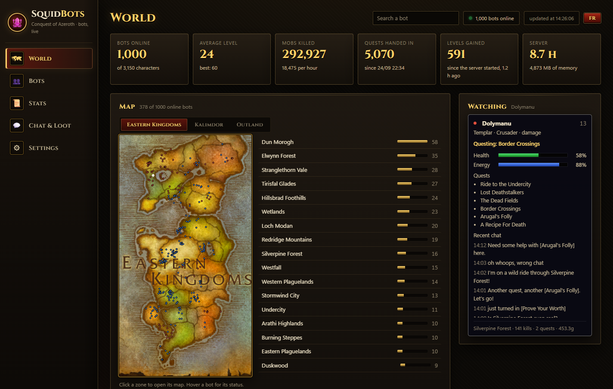
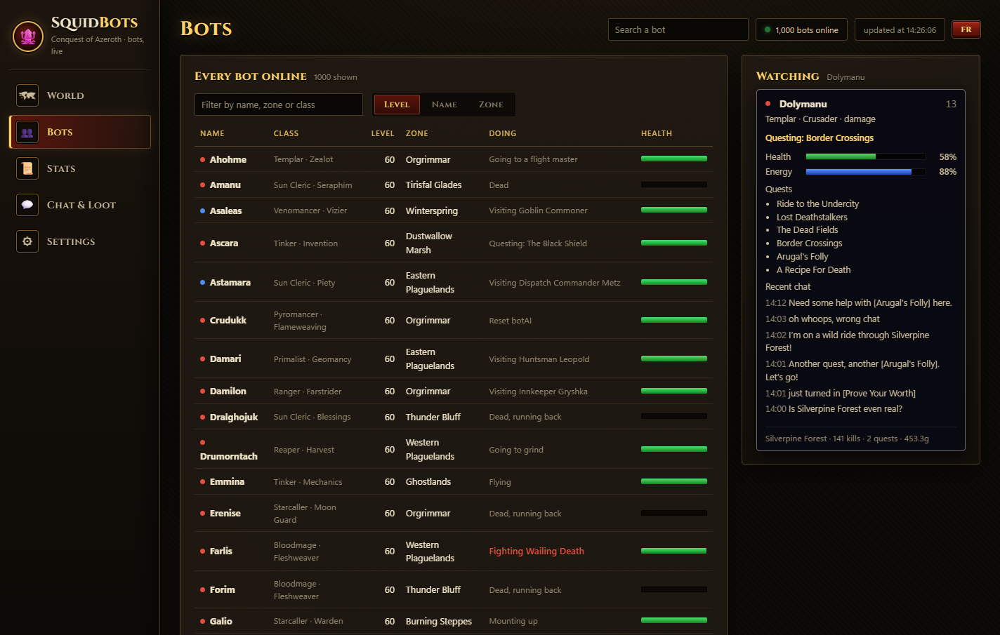
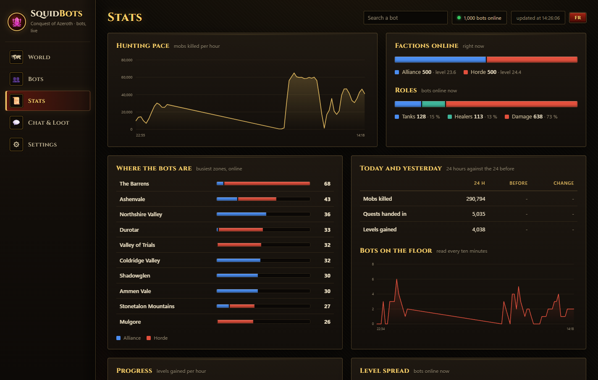
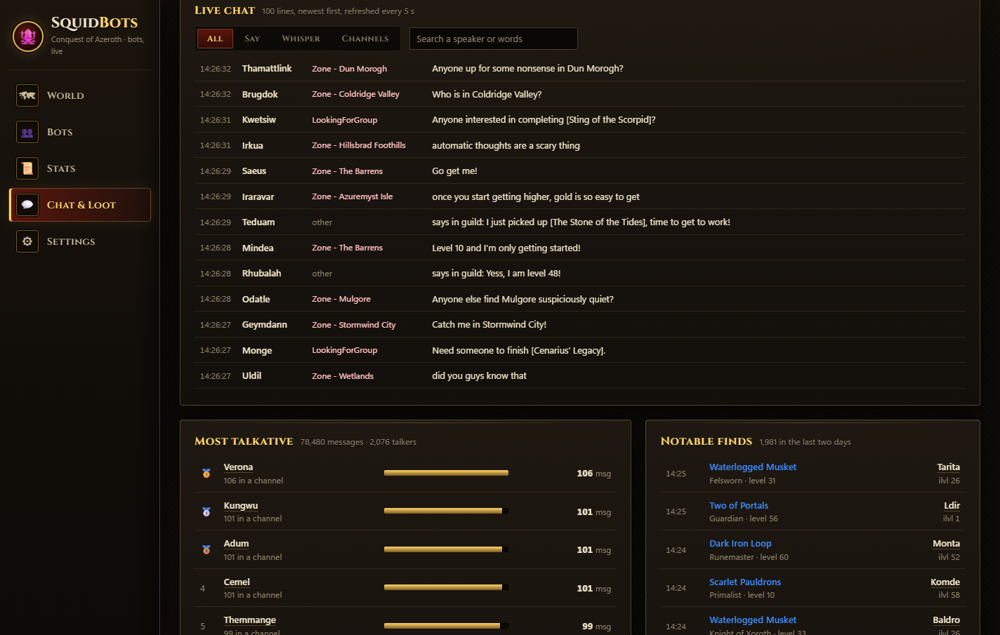

# SquidBots

**A live dashboard for an AzerothCore realm full of bots** — where they are, what they are doing,
what they kill, say and find, and whether the server held up while you slept.



**Current version: 3.1.0**, for **CoA Bots 3.1.x**. It ships inside the CoA Bots package, in
`CoA-Bots\Tools\Dashboard`, and the SquidBots Server launcher installs and updates it with the rest.

**News, new versions and support: the [SquidBots Discord](https://discord.gg/DTJceaG9Ky).**

Built for [Conquest of Azeroth](https://github.com/jealous-sound/azerothcore-wotlk-coa) with the
[SquidBots module](https://github.com/Zyth45/mod-playerbots) (mod-playerbots for Conquest of Azeroth); a plain
AzerothCore realm works too. It reads the game database and the worldserver's logs, never writes to
the database, and runs on the Python that ships with the repack: no framework, no build step, no
package to install, no request to any outside site.

It comes in two versions from the same code: a **private** one on `localhost` with everything,
including the server's health, its auction house and the game master tools, and a **public** copy of plain
files you can put on any web server. With the SquidBots Server launcher it follows every realm of the server: the
Conquest of Azeroth realm, and the Wildcard and Warcraft Reborn realms beside it.

## What you get

**World** — the headline figures, each continent's map with every bot on it (click a zone for its
own map, a bot for its card), and the bot you follow, live: the page at the top of this file.

| **Realms** | **Bots** |
|---|---|
|  |  |
| Every realm of the server side by side: online or not, bots and players, average level, the world's tick, memory, crashes, the bots of the last hours. | Every bot online, sortable and filterable: class, specialization, zone, what it is doing right now, health. |
| **Stats** | **Chat & Loot** |
|  |  |
| Hunting pace, factions and roles, busiest zones, today against yesterday, bots on the floor, level spread, stuck bots and crashes, experience per hour, leaderboard, spells cast, class ranking. | The live chat feed (private version; searchable, every 5 s), the most talkative bots, and the epics and rares they find. |
| **Server** (private version) | **Auction house** (private version) |
|  |  |
| The realm's tick, players, bots, memory, processor and crashes, over 24 hours and 7 days, with plain advice. | Auctions by house, by seller and by quality, the most expensive, the week's curve, and the auction house bot's commands. |

**Living world** (CoA Bots 3.0 and later) — what the bots do, from the files the module writes while the page is open
(nothing is written when nobody looks), in six tabs:

- **Population**: everyone online (players, their alts and bots, random bots), where they are (arena, battleground,
  raid, dungeon, capital, world), by faction and zone, what they do, and the XP catch-up (the players' front, random
  bots by level, hourly percentiles).
- **World life**: invasions, rushes, the capital raid, guilds and guild orders, server firsts, stuck bots over 24 h.
- **Economy**: auction house, crafting, gathering, smelting, disenchanting, prospecting and the auction house bot over
  24 h. An empty list says whether the feature is on and nothing happened yet, or which option turns it on.
- **Groups & dungeons**: real bot groups, simulated dungeons and battlegrounds, the last dungeon runs.
- **Health**: the bots' tick outside the ramp-up, and `CoaBots.log` live with a filter.
- **Journal**: the world's events.

A file a realm does not write says which option turns it on; no made-up figures.

**Game master** (private version) — a message to every player, and for a player of the list: kick, revive,
unstuck, mute, level, gold or an item by mail, ban, GM level. Each action is the server's own console command.


**PvP** — battlegrounds by type (games, wins per side, objectives, killing blows), arenas by
bracket (fights, average and median length), classes in battlegrounds and arenas, the top arena
teams, and the High Risk and War Mode characters, over the last 24 hours and since a date you pick
(`pvpSince` in `dashboard.json`; without it, the whole history). No character is named: a team
keeps its name only when all its members are random bots, otherwise it shows as a players' team.

**Every bot has a card.** Click it on the map, in the list or through the search box: class and
specialization, what it is doing (*Fighting Blackhand Thug*, *Questing: Border Crossings*,
*Dead, running back*...), its health and power, its group, its quests and what it said lately.

The live part — task, health, power, position to the second — comes from `bot-status.json`, which
mod-playerbots writes when `AiPlayerbot.CoaStatusFile` is set (see [Live status](#live-status)).
Without it the card falls back to the last character save: alive or dead, online or not.

English and French. The SquidBots launcher's own look (deep navy, teal light, the gold octopus crest and its line
icons), so the launcher and the dashboard read as one product. The Cinzel and Inter fonts are bundled under the SIL
Open Font License (`static/fonts/OFL.txt`).

## Several realms: CoA, Wildcard, Reborn

A server set up by the SquidBots Server launcher can run the Wildcard (Darkmoon) and Warcraft Reborn (Bronzebeard)
realms beside the CoA one, each in `<repack>\Royaumes\<key>` with its own characters, bots, journals and settings. The dashboard
finds them on its own, a realm created while it runs included, and only reads that folder. A realm picker appears in the side bar (each realm in the
launcher's colour); every page then shows the realm picked, and the **Realms** page shows all of them side by side.
`http://localhost:8088/?realm=wildcard` opens a realm directly. Without a Royaumes folder nothing changes, and
`"realms": false` in dashboard.json shows the CoA realm only.

The server's settings belong to the launcher (Management tab), which writes every .conf file again at each start: the
dashboard reads them and changes none. `"settingsPage": true` in dashboard.json brings back the Settings page for a
server run without the launcher; another realm's settings then go to `Royaumes\<key>\settings.json`, and
what the realm's game mode sets is shown greyed.

## Server health, auction house, game master (private version only)

**Server** — the realm's worldserver now and over 24 hours or 7 days: its tick (the time the world takes for one
update; under 100 ms is smooth), players and bots online, memory, processor, crash reports, its starts and stops, and
plain advice when something is off. One reading a minute: process figures straight from Windows and one
`server info` on the realm's console, never the database. `"monitorEvery": 0` turns it off, `"console": false`
leaves the console alone.

**Auction house** — the auctions by house, by seller (the auction house bot, random bots, players), by quality and by
kind of item, the most expensive ones and the week's curve; and the auction house bot's commands: run a cycle,
reload `mod_ahbot.conf`, take its auctions down.

**Game master** — for whoever runs the server from this PC: a message to every player (chat or on screen), save every
character, and for a player of the list kick, revive, unstuck, mute, set the level, send gold or an item, ban or
unban the account and set its GM level. Each action is the server's own command, sent to the realm's console with
the repack's console account (`Settings\repack.json`), checked before it leaves, and kept with its answer in
`data\gm-actions.jsonl`. It answers on 127.0.0.1 only and only to this page; `"gmTools": false` removes it.

## Install

**With CoA Bots** there is nothing to do: the dashboard is in `CoA-Bots\Tools\Dashboard`, already set up for the
repack, and opens at http://localhost:8088. An update keeps your `dashboard.json`.

**On another AzerothCore server**: it needs Python 3.9 or later and the `mysql` client binary.

1. Copy `squidbots.py`, `botconfig.py`, `index.html`, `worldmap.json`, `static/` and
   `dashboard.example.json` into a folder (`tools/` too if you want the real maps).
2. Rename the example to `dashboard.json` and fill in your paths. **Keep your database password
   out of it**: point `mysqlArgs` at a MySQL client file, or drop the folder inside a repack that
   has `Settings/database.json`. A second realm on the same MySQL names its own databases with
   `"databases": {"auth": ..., "characters": ..., "world": ...}`.
3. Run `python squidbots.py` and open http://localhost:8088 (or the `port` you set).

## Two versions: private and public

**Private** is the dashboard itself, on `http://localhost`. It has everything: Settings, the live
chat feed with every channel, memory, crashes and the watch journal. The server listens on
127.0.0.1 only, answers only requests addressed to that name (so a web page cannot rebind its own
name onto it), and accepts a write only as JSON from its own page (so another site cannot post a
form to it).

**Public** is what `publishDir` receives for a web server to serve: plain files (`index.html`,
`static/`, `worldmap.json`, `maps/`, `stats.json` once a minute, `live.json` every 12 s) and no
process anyone can reach. It is built, not filtered:

- `stats.json` carries only the keys listed in `PUBLIC_KEYS` in `squidbots.py`. A figure added
  later stays private until it is listed there.
- Never public: what real players say (no line of chat at all; "most talkative" counts bots only),
  memory, crashes, the watch journal, paths, configuration, errors.
- `live.json` carries only the bot fields the map and cards show (`PUBLIC_LIVE_FIELDS`), and no
  real player's name: a group led by a player loses its leader's name, a fight with a player reads
  "Fighting a player".
- The page's private code sits between `private:start` and `private:end` markers and is removed
  from the public files, not hidden. Publishing stops if anything private is left in them.

### On another PC of your network

The dashboard listens on this machine only (`http://localhost:8088`). To open it from another PC of
your home network, add a second port to `dashboard.json`:

```json
"lanPort": 8089
```

Then open `http://<the server PC's address>:8089` on the other PC (for example
`http://<this-pc-address>:8089`). This port serves the **public version**, read-only: the map, bots,
stats, chat counts, loot and PvP pages, without the Settings page, the real players' chat and
whispers, paths or crash details. Settings are still changed on the server PC itself, at
`localhost:8088`. Windows Firewall asks once whether Python may accept connections: allow it for
private networks only. `"lanListen": "<this-pc-address>"` limits the port to one network card.

## Logs some cards need

Add these to `worldserver.conf` and restart; until then the cards stay empty and say so.

Spells cast, and rare finds (both need the [SquidBots module](https://github.com/Zyth45/mod-playerbots)):

```ini
Appender.CoaBots = 2,4,1,CoaBots.log,a
Logger.playerbots.coa = 4,CoaBots
Appender.BotLoot = 2,4,1,BotLoot.log,a
Logger.playerbots.loot = 4,BotLoot
```

Chat feed and most talkative: the bots' own lines (the module writes them, since a bot sends no chat
packet), and the players' chat if you want it too (stock AzerothCore):

```ini
Appender.Chat = 2,4,1,Chat.log,a
Logger.playerbots.chat = 4,Chat
# optional, the players' chat:
ChatLog.Enable = 1
Logger.chat.say = 4,Chat
Logger.chat.yell = 4,Chat
Logger.chat.channel = 4,Chat
Logger.chat.whisper = 4,Chat
Logger.chat.party = 4,Chat
Logger.chat.guild = 4,Chat
```

The PvP page's battlegrounds need `Battleground.StoreStatistics.Enable = 1`.

The Chat & Loot and PvP pages offer a **Turn the journals on** button when these lines are missing:
it sets the required ones in place, after a backup of `worldserver.conf`.

## The Settings page

Only for a server run without the SquidBots Server launcher, with `"settingsPage": true` in `dashboard.json`: the launcher
owns the settings of its servers and writes every `.conf` file again at each start. The page changes values in the module `.conf` files (`playerbots.conf`, `dynamicxp.conf`, and
`mod_bot_minds.conf` when [mod-bot-minds](https://github.com/vedicveko/mod-bot-minds) is
installed). It edits values in place and never reorders lines; the only line it may add is the bots'
chat language, at the end of `playerbots.conf`, when an older file lacks it. It backs the whole file up to
`config-backups/` first. Each setting says when a change takes effect. The server reads these
files at startup, so it is easiest to use with the server stopped. Writes are accepted from the
machine itself only, from the dashboard's own page. The dashboard never writes to the game database.

## Armory

The Armory page finds any character, bot or player, by the start of its name and opens its sheet: the
gear in the game's paper-doll order with quality colours, item level and a tooltip (damage, stats,
enchantment, gems), the average item level, stats, professions and the latest achievements. Links such
as `#armory/Name` open a sheet directly. It is on the dashboard's own page, so also in the CoA Server
Manager's "Dashboard" tab (which shows that page); the public copy and the LAN page leave it out.

It reads the same databases with the same mysql client as the other pages, read-only; a typed name is
letters (one space at most) and is sent as a hex literal, never pasted into the query. Names of enchantments, gems,
suffixes, professions and achievements come from the server's `data/dbc` folder (`dbcDir`, found on
its own in a repack); without it, the sheet shows numbers ("Achievement #6") and says so.

Item icons, in this order:

1. The icon's name for the item's look: `world.itemdisplayinfo_dbc` (`InventoryIcon_1`; Conquest of
   Azeroth's own looks are there), else `ItemDisplayInfo.dbc` in the dbc folder.
2. The picture from a game client on this PC: `gameClient` in `dashboard.json`, else a client found
   beside the repack, in a usual install folder or one or two folders under a local disk's root (one
   holding `Data/common.MPQ`). Each icon is read the first time a sheet shows it and kept in `icons/`
   (git-ignored, Blizzard's art, never published).
3. Otherwise the browser loads it from `https://wow.zamimg.com/images/wow/icons/large/<name>.jpg`.
   Custom CoA icons are not there: those items keep their quality-coloured frame. `"webIcons": false`
   in `dashboard.json` turns this step off, so that the page asks no outside site for anything.

Stats are the server's own when `PlayerSave.Stats.MinLevel` is above 0 in `worldserver.conf`;
otherwise the sheet adds up the gear and says so. Nothing new is needed from the module.

## Map

`worldmap.json` (rebuilt by `tools/gen_worldmap.py`) gives the map its zones out of the box: each
zone is a rectangle in world coordinates, with the bots as dots.

For the real continent and zone maps, press **Extract maps** (above the map, or under Settings) and
give your game client folder. In about two minutes they are written to `maps/` (about 70 MB),
with nothing to install. The same from a terminal:

```bash
python tools/gen_art.py --client C:\my-client --dbc C:\my-server\server\data\dbc
```

**In the CoA Bots repack** the dashboard is `CoA-Bots\Tools\Dashboard`, with its `tools` folder, and the
map works at once with the zone outlines. For the real maps, press **Extract maps** above the map and
give the folder of your game client (the one holding `Data\common.MPQ`), or run from
`CoA-Bots\Tools\Dashboard`, with the repack's own Python:

```bat
..\..\..\Runtime\python\python.exe -B tools\gen_art.py --client "C:\path\to\your\client" --dbc ..\..\..\Data\dbc
```

then reload the page. The maps are taken from your own client, so the release does not ship them.

The maps are Blizzard's and are git-ignored. With `publishDir` set, they are copied beside the public
page (about 70 MB, only new or changed files), so the public map looks like the local one; without
`publishDir` they never leave your machine. No other game art (interface, frames, icons) is used.

## Live status

Bots are placed from their last character save. For live positions, and for what each bot is doing
on its card (health, power, task, group, quests), let mod-playerbots write a `bot-status.json` every
few seconds and point `botStatusFile` in `dashboard.json` at it:

```ini
# configs/modules/playerbots.conf
AiPlayerbot.CoaStatusFile = "C:/my-server/server/logs/bot-status.json"
AiPlayerbot.CoaStatusIntervalSeconds = 5
```

It is off by default. With 1000 bots online a snapshot costs under a millisecond of the world
update, and the disk write runs on a thread of its own. A file older than 60 s is treated as stale
(the server has stopped writing it).

## The watchman

`watch-and-restart.ps1` checks the worldserver every minute and restarts it after a crash or a
freeze (a log untouched for five minutes), capturing thread stacks before killing a frozen one.

```powershell
powershell -ExecutionPolicy Bypass -File watch-and-restart.ps1 -Server C:\my-server\server
```

Its journal shows in the Stats page (`incidentsLog`). Once an hour it trims `Chat.log` in place to
the last 24 hours (`-TrimLogs`, `-TrimHours`, `-TrimEveryMinutes`). Discord alerts are opt-in: put
a webhook URL in `alerte-discord.txt` next to the script.

## Notes

- Figures follow `PlayerSaveInterval`: a kill shows when the character is saved. Rates use a
  sliding half hour for that reason.
- `baseline.json`, `history.json` and `xp-history.json` are written next to the script; delete
  `baseline.json` to restart the "gained since" figures.
- `footer` in the settings replaces the page's footer line; `""` removes it.

## Contributors

A big thank you to **[Sass42](https://github.com/Sass42)**, whose
[pull request #1](https://github.com/Zyth45/squidbots-dashboard/pull/1) turned a single page of
figures into the dashboard you see above: the side navigation and its five pages, the continent and
zone maps with the bots on them, the bot cards, the sortable roster, the live chat feed, the
Settings page with its explanations, override warnings and recipes, and the tool that extracts the
maps from your own client with nothing to install. The live bot status on the cards grew out of
their work too. Thank you!

Pull requests are welcome. Questions and bug reports: the [SquidBots Discord](https://discord.gg/DTJceaG9Ky) or an
issue on this repository.

## Credits

- [jealous-sound](https://github.com/jealous-sound/azerothcore-wotlk-coa) for Conquest of Azeroth
- [mod-playerbots](https://github.com/mod-playerbots/mod-playerbots) for the bots
- [Sass42](https://github.com/Sass42) for the pages, the maps, the bot cards, the chat feed and the
  Settings page
- Written with [Claude Code](https://claude.com/claude-code); reviewed, tested and run on a real
  server with a thousand bots.
